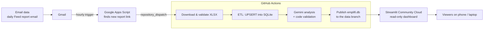

# Social Media Dashboard

An automated reporting pipeline that turns daily Data email reports into a live,
mobile-friendly web dashboard. No manual exports, no Looker Studio, and it runs
entirely on free tiers.


**Live demo:** _add your Streamlit link here_

---

## The problem

The social team received an email data "Feed" report as an Excel attachment link by
email every day. Someone had to download it, clean it, and paste it into a Looker
Studio report. Posts with several campaign labels were counted more than once,
older reports sometimes overwrote newer numbers, and the client mostly checked
results on their phones.

## What I built

- **Hands-off ingestion.** A Google Apps Script picks up new report emails and
  triggers a GitHub Actions workflow, which downloads the Excel file, validates it,
  and loads it into SQLite.
- **A dashboard anyone can open.** Streamlit Community Cloud serves it, so viewers
  just open a link with no login or install, and it refreshes itself when new data
  lands.
- **A data model that doesn't double count.** One row per post (Content ID), with
  labels in a separate bridge table. Totals always come from unique posts.
- **AI with guardrails.** Gemini (free tier) assigns topic categories, detects
  mentions of the brand app and ambassadors, and writes a short "what happened"
  summary. Every AI output is checked by code before it is stored.
- **Built for phones.** It uses one card style for posts and figures, keeps charts
  static so touch doesn't zoom them, and adds a "data source" line under every
  section.

## Architecture



Everything runs on free plans: Gmail + Apps Script, GitHub Actions on a private
repo, Streamlit Community Cloud, and the Gemini API free tier.

## Data accuracy decisions

| Problem | How it's handled |
|---|---|
| A post with several campaign labels is counted several times | Metrics live on one row per Content ID. Labels sit in a bridge table without metrics, so filtering by label selects posts first and sums second |
| An older report overwrites newer numbers | UPSERT only updates a post when the report's email date is newer than the stored one |
| A broken file leaves the database half-updated | Each report is one transaction (`BEGIN IMMEDIATE`): all rows land or none do. Failures are logged and shown in the dashboard |
| The same file is processed twice | Files are fingerprinted with SHA-256 and skipped if already imported |
| Labels that don't follow the naming convention | `Pillar: X` and `Tower - Campaign - Sub` are parsed. Anything else is kept as "Other label" instead of failing the import |
| Wrong link opened from the dashboard | Only the "View on platform" hyperlink (and similar permalink columns) is used. "Link URL" (the link inside a post) and profile URLs are never used |
| Competitor posts mixed into own KPIs | Competitors are identified by account name only, kept in a separate frame, and never enter KPIs or rankings |

## AI guardrails

The AI only ever sees post captions and engagement figures. Reach and impressions
are never sent. Its output is treated as untrusted:

1. **Fixed topic list.** The model must choose from a predefined set of categories
   through a JSON schema, so it can't invent new ones.
2. **Quoted evidence.** A name mention (for example an ambassador) is accepted only
   if the model quotes text that exists in the caption and the quote contains that
   name. Ambiguous words get an extra rule. In the demo, "Taraa!" (Indonesian for
   "ta-da!") is not counted as the ambassador *Tara Senandika*.
3. **Numbers come from code.** The summary is written from facts the system
   calculates. Every number in the AI's sentences must match a number in those
   facts, and every `[P1]` reference must point to a real post. If anything fails,
   the model gets one retry, and after that the summary is discarded.
4. **Nothing gets translated.** Hashtags and quoted captions must match the
   original text exactly.
5. **No injected links.** Sentences containing URLs, domains, HTML, or markdown
   links are rejected. This blocks prompt injection hidden in a caption.

These rules are covered by `tests/test_ai.py`, which runs a deliberately lying
fake model.

## Security

- The dashboard opens the database read-only and is served from a private
  repository's data branch through a read-only token.
- Secrets live in GitHub Actions secrets, Streamlit secrets, and Apps Script
  properties. None are in the code.
- Caption text is HTML-escaped before rendering. Error details go to server logs,
  not to visitors.
- Data downloads (CSV/Excel buttons and table toolbars) are disabled on the public
  dashboard.
- Optional access modes are already implemented and can be switched on from
  Streamlit secrets: a secret link (`?kunci=`), a shared password, or Google login
  with an email allowlist.

## Performance

The first version built caption and sentiment columns in an SQL view by
re-reading raw JSON rows for every post. With 6,000 posts the dashboard query ran
for over two minutes. These fields are now copied into the main table during
ETL, and old databases are backfilled automatically. The same query now takes
about 0.1 s, and every dashboard section computes in under 0.2 s.

## Tech stack

Python · pandas · openpyxl · SQLite · Streamlit · Plotly · Google Apps Script ·
GitHub Actions · Gemini API

## Repository layout

```
etl_emplifi.py          ETL: validate, UPSERT, labels, links, logging
db_sqlite.py            Schema, views, migrations, pruning
validate_feed.py        Feed report validation
extract_hyperlinks.py   Extracts hidden "View on platform" hyperlinks from Excel
process_link.py         Downloads a report link (host allowlist, size/format checks)
ai_analysis.py          Gemini topic/mention analysis + summary with validation
brand_watch.py          Brand app, ambassadors, competitors, account grouping
log_status.py           Records failures so they show on the dashboard
settings.py             Database location (env var / config.json)
dashboard/              Streamlit app (app.py), data layer (data.py), charts (viz.py)
apps_script/            Gmail -> GitHub trigger (Google Apps Script)
.github/workflows/      Ingestion + AI + publish workflow
tests/                  ETL end-to-end tests and AI guardrail tests
demo/                   Fictional data generator and the demo database
```

The code identifiers and comments are in Indonesian, the language the project was
built in. The dashboard UI is in English.

## Run it locally

```bash
pip install -r requirements.txt

# optional: rebuild the fictional demo database (already included)
python demo/generate_demo_data.py

streamlit run dashboard/app.py
```

Run the tests:

```bash
python tests/test_etl.py    # 48 end-to-end ETL checks on a temporary database
python tests/test_ai.py     # 25 AI guardrail checks with a fake model (no API key needed)
```

## Deploy the demo

1. Push this repo to GitHub.
2. On [share.streamlit.io](https://share.streamlit.io), create an app with main
   file `dashboard/app.py`.
3. No secrets are needed. The app reads `demo/emplifi_demo.db` through
   `config.json`.

## Production setup (summary)

1. Keep the repository **private**. The `data` branch holds the database.
2. Add `GEMINI_API_KEY` to GitHub Actions secrets. This is optional, and without
   it the AI sections simply stay hidden.
3. Paste `apps_script/SendEmplifiReport.gs` into Apps Script under the Gmail
   account that receives the reports. Set `GITHUB_TOKEN` and `GITHUB_REPO` in
   Script Properties, then run `installSchedule` once to install the hourly trigger.
4. Deploy the dashboard on Streamlit and add a `[github]` section (read-only
   token, repo, branch `data`) to its secrets.

## Known limitations

- The Emplifi Feed report contains comment **counts** per sentiment, not comment
  text. Comment sentiment therefore follows Emplifi's own classification, and the
  dashboard can't show what individual comments say.
- Anyone with the public link can see the data. Downloads are disabled, but
  screenshots can't be prevented. Switch on one of the access modes if that
  matters.
- Free tiers have limits: Streamlit apps sleep when idle, and the Gemini free tier
  has daily quotas. AI analysis catches up on the next run.
